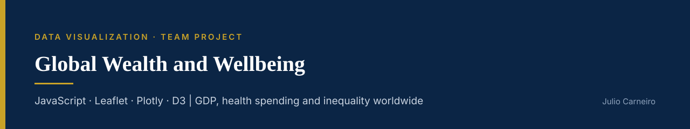

# Global Wealth and Wellbeing

**Interactive dashboards and maps comparing GDP, healthcare spending, income inequality and population density across countries, built from Our World in Data.**

     

**[Open the Economic Indicators Dashboard](https://juliocezarcarneiro.github.io/global-wealth-and-wellbeing/Dashboard/index.html)**

---

## Business problem

How are national wealth, public health investment and income distributed around the world, and who benefits most from development? The project answers four questions:

1. How has the wealth of the world's richest countries evolved over time?
2. How have living standards changed, and who benefits most?
3. How do population density, national wealth and health spending relate?
4. How has income inequality (GINI index) changed across countries?

## Approach

1. **Collect** five Our World in Data series: GDP per capita, healthcare spending per capita, GINI index, population density and World Bank income groups.
2. **Clean and merge** them in Python (pandas), keeping missing values as null instead of guessing.
3. **Store** the merged data in MongoDB and export it as JSON for the web.
4. **Visualize** with an interactive dashboard and four maps (D3, Plotly and Leaflet), published on GitHub Pages.

## Key findings

| Finding | Country | Why |
|---|---|---|
| Wealthiest nation, 3rd in health spending | Luxembourg | Small population, global financial centre, tax policies that attract investment |
| Highest healthcare spending | Switzerland (then Austria, Germany) | Universal healthcare and older populations needing long-term care |
| Highest inequality (GINI) | South Africa | Wealth concentrated in a small minority; legacy of apartheid, high unemployment |
| High income, low density, low inequality | Canada, United States | GDP and health spending above the world average |

**Limitations:** some countries have incomplete data, some indicators end in 2021, and the project explores patterns without statistical tests of correlation or causality.

## Visuals

| Visualization | What it shows |
|---|---|
| [Economic Indicators Dashboard](https://juliocezarcarneiro.github.io/global-wealth-and-wellbeing/Dashboard/index.html) | GDP, health spending and population by country and year |
| [GINI Index Map](https://juliocezarcarneiro.github.io/global-wealth-and-wellbeing/choropleth_map/index.html) | Income inequality around the world |
| [GDP & GINI Map (Plotly)](https://juliocezarcarneiro.github.io/global-wealth-and-wellbeing/MAPS/Plotly/plotly_choropleth_gdp_gini.html) | Wealth and inequality side by side |
| [GDP Choropleth (Leaflet)](https://juliocezarcarneiro.github.io/global-wealth-and-wellbeing/MAPS/Leaflet/leaflet_choropleth_tiles.html) | GDP per capita on a tiled map |
| [Income Classification Map](https://juliocezarcarneiro.github.io/global-wealth-and-wellbeing/MAPS/Leaflet/Income_class.html) | World Bank income groups |

## How to run

```bash
git clone https://github.com/juliocezarcarneiro/global-wealth-and-wellbeing.git
cd global-wealth-and-wellbeing
python3 -m http.server 8000
```

Then open `http://localhost:8000/Dashboard/index.html`. To rebuild the data, run the notebooks in `Data Cleaning and Storage/` (requires `pip install -r requirements.txt` and a local MongoDB for the setup notebook).

## Folder structure

```text
global-wealth-and-wellbeing/
├── Data Cleaning and Storage/   # cleaning notebooks, MongoDB setup, raw and merged data
├── Dashboard/                   # main interactive dashboard
├── choropleth_map/              # GINI index map
├── MAPS/
│   ├── Leaflet/                 # GDP and income-class maps
│   └── Plotly/                  # GDP & GINI map
└── assets/                      # banner
```

## Team

Anqa Javed, Humaira Enayetullah, Julio Carneiro, Shahab Eshghifard
University of Toronto Data Analytics Bootcamp

**Data:** Our World in Data: [GDP per capita](https://ourworldindata.org/grapher/gdp-per-capita-worldbank), [GINI index](https://ourworldindata.org/grapher/economic-inequality-gini-index), [healthcare expenditure](https://ourworldindata.org/grapher/annual-healthcare-expenditure-per-capita), [population density](https://ourworldindata.org/grapher/population-density), [population](https://ourworldindata.org/grapher/population). Maps use [Leaflet](https://leafletjs.com).

## Contact

**Julio Carneiro** · Data Analyst · Toronto, ON
[LinkedIn](https://www.linkedin.com/in/juliocezarcarneiro/) · [Portfolio](https://github.com/juliocezarcarneiro) · [Email](mailto:juliocezarcarneiro@outlook.com)
